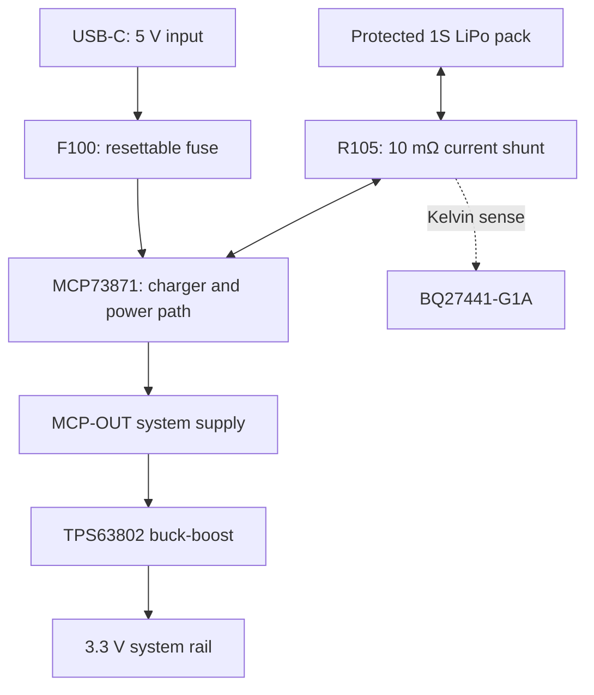

# Secure-Ready Battery-Powered Edge Logger

**ESP32-C3 · KiCad 10 · Zephyr RTOS · Battery monitoring · Offline timekeeping · Secure element**

A custom embedded platform for collecting environmental, light, and acoustic signals, storing data locally, and developing battery-aware logging applications. The hardware combines an ESP32-C3 with a buck-boost power supply, a fuel gauge, a battery-backed RTC, and a dedicated secure element.

*CAD rendering of the revised design. Hardware fabrication and bench validation are pending.*

| Project area | Current state |
|---|---|
| Hardware | Rev 2 schematic and PCB design in KiCad 10 |
| Firmware | Custom Zephyr board port; build validation reported in the firmware repository |
| Physical validation | Pending PCB fabrication and bring-up |
| Security | SE050E2 hardware and middleware integration; application provisioning remains to be completed |
| Manufacturing | NextPCB is the intended manufacturer; procurement and release checks remain open |

## Contents

- [Design evolution](#design-evolution)
- [Rev 2 hardware](#rev-2-hardware)
- [Power architecture](#power-architecture)
- [Interfaces and pin mapping](#interfaces-and-pin-mapping)
- [Programming and debugging](#programming-and-debugging)
- [Firmware integration](#firmware-integration)
- [Manufacturing and validation](#manufacturing-and-validation)
- [Repository and design files](#repository-and-design-files)
- [Technical references](#technical-references)

## Design evolution

The project began as the **IoT Development Board**, a general-purpose ESP32-C3 design combining sensing, wireless connectivity, local storage, USB-to-UART programming, and single-cell battery charging.

**Rev 2** develops that architecture around unattended data logging. Its main additions address supply regulation as the battery discharges, visibility into battery state, timekeeping without a network connection, and protected cryptographic credentials.

| Function | Rev 1 — IoT Development Board | Rev 2 — Secure Edge Logger |
|---|---|---|
| Controller | ESP32-C3-WROOM-02-H4 | ESP32-C3-WROOM-02-H4 |
| System regulation | LM1117-3.3 linear regulator | TPS63802 buck-boost converter |
| Charging / load sharing | MCP73871 | MCP73871 |
| Battery monitoring | Charger status outputs | BQ27441-G1A and 10 mΩ four-terminal shunt |
| Absolute time | Requires a software time source | DS3231SN with separate backup-cell connection |
| Security hardware | ESP32-C3 platform capabilities | Adds NXP EdgeLock SE050E2 |
| Sensors | BME280, TEMT6000, electret microphone and MAX4466 | Same sensing architecture |
| Local storage | External SPI NOR and SD-card socket | Same architecture, with revised bus pull-ups |
| Programming interface | USB-to-UART architecture | CP2102N-A02-GQFN24 with dedicated DTR/RTS outputs |

A linear regulator requires input headroom above its output. A 1S LiPo supply eventually falls below the voltage needed to maintain a regulated 3.3 V rail through an LM1117. The buck-boost stage can both raise and lower its input voltage, extending the usable operating range. Final operation still depends on the pack cutoff, load, conversion losses, and thermal performance.

## Rev 2 hardware

| Subsystem | Reference | Selected device | Interface / role |
|---|---|---|---|
| MCU and radio | U203 | ESP32-C3-WROOM-02-H4 | RISC-V processor, 2.4 GHz Wi-Fi, Bluetooth LE, 4 MiB module flash |
| USB-to-UART | U200 | CP2102N-A02-GQFN24 | UART0 console and programming; DTR/RTS boot control |
| USB data protection | U201 | USBLC6-2SC6 | ESD protection on USB D+/D− |
| Charger / power path | U100 | MCP73871-2CAI/ML | 4.2 V single-cell charging and system load sharing |
| System regulator | IC100 | TPS63802DLAR | Nominal 3.3 V buck-boost conversion |
| Battery fuel gauge | IC101 | BQ27441DRZT-G1A | I²C battery-state estimation |
| Current sensing | R105 | WSK2512R0100FEA | 10 mΩ, four-terminal Kelvin shunt |
| Environmental sensing | U300 | BME280 | Temperature, humidity, and pressure over I²C |
| Ambient light | Q300 | TEMT6000X01 | Analog input to ADC1 |
| Acoustic input | MK300 / U303 | CMC-5042PF-AC / MAX4466EXK+T | Electret microphone and analog preamplifier |
| Real-time clock | U301 | DS3231SN# | I²C calendar/time, alarm or square-wave output |
| Secure element | U302 | SE050E2HQ1/Z01Z3Z | I²C transport for protected keys and cryptographic operations |
| External NOR | U202 | W25Q32JVSSIQ | 32 Mbit / 4 MiB SPI storage, separate from module flash |
| Removable storage | J200 | GSD090012SEU | **Full-size SD** socket, connected for SPI operation |

The microphone path exposes an analog waveform to the MCU. Sampling rate, filtering, calibration, and any acoustic metrics are application responsibilities. The light input likewise requires calibration before reporting an absolute illuminance value.

### PCB construction

The current CAD specifies a **four-layer, 1.60 mm PCB** with an approximate **82.0 × 54.2 mm** outline envelope. The outline includes an antenna clearance cutout; the CAD outline and connector drawings define the enclosure fit.

| Copper layer | Contents in the current design |
|---|---|
| F.Cu | Components, signal routing, and local power/ground pours |
| In1.Cu | Ground zone |
| In2.Cu | Power distribution zones |
| B.Cu | Additional signal routing |

The fabrication stackup and USB differential geometry must be agreed with NextPCB. The stackup stored in CAD alone does not establish the manufactured impedance.

## Power architecture

### Charging and system supply

- **Input:** 5 V USB power through J100. Separate 5.1 kΩ resistors terminate CC1 and CC2. The design has no USB Power Delivery controller.
- **Charge target:** the selected MCP73871 variant charges a 1S Li-ion/LiPo pack to 4.2 V. R114 = 2 kΩ requests approximately **500 mA** nominal charge current, subject to available input current and thermal regulation.
- **Input limit:** the current wiring selects the MCP73871 USB mode with a nominal **500 mA total input limit** (`SEL` low, `PROG2` high). The system and charger share that budget. A higher-rated USB adapter does not change these hardware settings.
- **Temperature sensing:** J102 connects an external battery thermistor. The sensor and harness must be selected for the charger and thermally coupled to the pack.
- **Pack protection:** use a qualified protected battery pack with suitable discharge, charge, and temperature ratings. Pack protection provides the required cell cutoff behavior; the charger manages charging and load sharing.

### 3.3 V regulation and battery measurement

The TPS63802 uses a 470 nH inductor and a 511 kΩ / 91 kΩ feedback divider for approximately 3.3 V. `EN` follows the system supply and `MODE` is tied low for power-save operation. The converter's rated current is a component specification; the board's continuous and peak current capability must be established for the complete power path.

The BQ27441 measures battery current across R105 using separate sense connections. Firmware must configure the gauge for the actual pack capacity, charge-termination behavior, and operating limits. Battery runtime, idle consumption, load-step margin, and charging temperature rise remain measurements to establish on the assembled board.

### RTC backup supply

BT300 is a **Keystone 2998 / 2998TR holder**, supplied separately from its cell. Its footprint accepts a 6.8 mm cell; it is incompatible with a CR2032.

The previously considered MS621FE is a rechargeable 3 V cell, but the current PCB provides **no RTC-cell charging circuit**. A final cell and charging/replacement plan must be qualified. Keep the backup supply within the DS3231's specified range, including its 2.3 V minimum. This backup connection supplies the RTC during loss of main power; it does not run the MCU or preserve an unfinished storage write.

## Interfaces and pin mapping

The following assignments come from the revised Rev 2 PCB connections.

### MCU signals

| ESP32-C3 signal | Function | Connected hardware |
|---|---|---|
| GPIO0 / ADC1_CH0 | Microphone input | MAX4466 output |
| GPIO1 / ADC1_CH1 | Light input | TEMT6000 analog node |
| GPIO2 | SPI MISO | SD and external NOR return data |
| GPIO3 | I²C SCL | Shared peripheral bus |
| GPIO4 | I²C SDA | Shared peripheral bus |
| **GPIO5** | **RTC INT/SQW** | DS3231 open-drain output |
| GPIO6 | SPI SCLK | SD and external NOR clock |
| GPIO7 | SPI MOSI | SD CMD / NOR DI |
| **GPIO8** | **SD chip select** | SD DAT3 / CS |
| GPIO9 | BOOT | S400 and automatic boot circuit |
| GPIO10 | External NOR chip select | W25Q32 CS# |
| GPIO18 | Native USB D− / GPIO | BREAKOUT400 pin 2 |
| GPIO19 | Native USB D+ / GPIO | BREAKOUT400 pin 3 |
| GPIO20 / U0RXD | UART receive | CP2102N TXD |
| GPIO21 / U0TXD | UART transmit | CP2102N RXD |
| EN | Hardware enable / reset | S401 and automatic reset circuit |

GPIO2, GPIO8, and GPIO9 are strapping pins. Their levels during reset must remain compatible with boot requirements. Moving the RTC interrupt to GPIO5 prevents an asserted RTC alarm from pulling GPIO8 low during download-mode entry. SD CS has a 10 kΩ pull-up; BOOT uses the ESP32-C3's internal weak pull-up in the current circuit.

### I²C bus

SDA and SCL each have a **4.7 kΩ pull-up to 3.3 V** through R300/R301. The firmware baseline uses 100 kHz. Addresses below use the **7-bit convention**.

| Device | Address | Configuration |
|---|---:|---|
| BME280 | `0x76` | SDO grounded; CSB tied high for I²C |
| BQ27441-G1A | `0x55` | Fixed device address |
| DS3231SN | `0x68` | Fixed device address |
| SE050E2 | `0x48` default | Use the NXP protocol/middleware and confirm provisioned configuration |
| External OLED | Module-dependent | Select the exact controller, address, and application overlay |

The RTC `INT/SQW` connection has its own **4.7 kΩ pull-up** through R303. Firmware selects alarm or square-wave operation and clears the relevant alarm flags when using interrupts. An OLED module's pull-ups combine with the board's pull-ups; verify their voltage and effective resistance.

### Shared SPI storage

SD and NOR share SCLK, MOSI, and MISO with separate active-low chip selects. R205–R208 are 50 Ω series damping resistors; these serve a different purpose from pull-ups.

| Network | Implementation |
|---|---|
| SD DAT3 / CS | 10 kΩ pull-up, R209 |
| SD CMD / MOSI | 10 kΩ pull-up, R210 |
| SD DAT0 / MISO | 10 kΩ pull-up, R211 |
| SD DAT1 and DAT2 | 10 kΩ pull-ups, R212/R213; unused for SPI transfers |
| External NOR CS# | 10 kΩ pull-up, R214 |

During initialization, establish both chip selects high, observe each device's startup timing, and initialize the SD card using its SPI-mode sequence. Use a shared bus lock for transfers. Validate the selected card, clock rate, NOR access, and MISO release with both devices fitted. The socket's card-detect and write-protect contacts are unconnected.

TP1–TP5 provide access to MISO, MOSI, SD CS, NOR CS, and SCLK respectively.

### External connectors

Pin numbers refer to the PCB footprint numbering. Check the physical pin-1 marker and mating cable drawing before connecting a module or pack.

| Connector | Purpose | Pin assignment |
|---|---|---|
| J100 | USB-C | 5 V power and USB data to the CP2102N |
| J101 | Main battery, JST PH 2.00 mm | **1 = GND, 2 = battery positive** |
| J102 | External thermistor, JST ZH 1.50 mm | **1 = THERM, 2 = GND** |
| OLED400 | I²C display header, 2.54 mm | **1 = 3.3 V, 2 = SCL, 3 = SDA, 4 = GND** |
| BREAKOUT400 | Native USB / GPIO header, 2.54 mm | **1 = 3.3 V, 2 = GPIO18, 3 = GPIO19, 4 = GND** |

The OLED header order must be matched with a correctly wired cable. The exact OLED module, SD card, main pack, thermistor harness, and RTC cell are external selections that require final qualification. GPIO8 is occupied by SD CS and is unavailable as a spare expansion signal.

## Programming and debugging

### USB-to-UART and automatic boot

J100 routes USB data through U201 to the **CP2102N-A02-GQFN24**. The bridge uses the board's 3.3 V supply, VBUS sensing, and a 1 kΩ reset pull-up. UART connections cross correctly: bridge TXD to MCU RXD, and bridge RXD to MCU TXD.

The QFN24 package exposes dedicated **DTR# on pin 23** and **RTS# on pin 19**. Q400/Q401 form the two-transistor automatic boot/reset circuit, controlling EN and GPIO9. The EN network uses R402 = 10 kΩ and C401 = 1 µF. C400 on BOOT is marked **DNP**. CTS is unused.

The TX/RX indicator pins require the intended alternate-function configuration in Silicon Labs' configuration tools. Confirm automatic bootloader entry and the CP2102N's USB behavior during bring-up.

### Manual bootloader entry

1. Connect USB and identify the CP2102N serial port.
2. Hold **BOOT** (S400).
3. Press and release **EN** (S401) while continuing to hold BOOT.
4. Release BOOT after the reset sequence, then start the UART upload.
5. Reset with EN after flashing if required by the flashing tool.

### Native USB/JTAG

Native ESP32-C3 USB Serial/JTAG signals are exposed on GPIO18/GPIO19 through BREAKOUT400. J100 is connected to the CP2102N, so native debugging requires a separately qualified connection to the breakout. Preserve signal polarity, routing, protection, and power-domain compatibility when designing that connection.

## Firmware integration

Firmware lives in the separate [Zephyr RTOS Port repository](https://github.com/landjas09/Zephyr-RTOS-Port). The custom target is `iot_sensor_node_esp32c3`; the port is documented against **Zephyr 4.2.0-rc1** and reuses Zephyr's ESP32-C3 SoC support.

The port describes UART, I²C, SPI storage, ADC inputs, BOOT, the RTC, and the fuel gauge through Devicetree and pinctrl. SE050 transport is exposed to **NXP Plug & Trust** through the `se05x-i2c` bus alias. A selected OLED belongs in an application overlay.

The [firmware source snapshot reviewed for this README](https://github.com/landjas09/Zephyr-RTOS-Port/blob/58783257153c90eb4e6a9b5f736847d94d9d9c50/iot_sensor_node_esp32c3.dts) already maps RTC interrupt to GPIO5 and SD CS to GPIO8. Older prose in that repository still shows the previous assignments.

### Configuration to reconcile before hardware testing

| Item | Required alignment |
|---|---|
| External NOR capacity | W25Q32 is **32 Mbit / 4 MiB**. In the reviewed source, `size = <0x400000>;` describes 4 Mbit because the Zephyr `jedec,spi-nor` binding uses **bits**. Set `size = <0x2000000>;` for this device and rebuild. |
| Fuel-gauge configuration | The reviewed source contains a 2000 mAh capacity assumption. Set capacity, taper current, and termination voltage for the qualified pack and charging configuration. |
| Storage clocks | Validate the configured 25 MHz SD ceiling and NOR speed on the assembled board; start conservatively during bring-up. |
| RTC | Initialize valid time, check oscillator-stop status, and implement alarm-flag handling. |
| Security | Define key provisioning, access policy, and the application's signing/authentication workflow. |
| Low-power behavior | Measure the complete board, including bridge, LEDs, sensors, gauge, and storage; MCU sleep current alone is insufficient to predict runtime. |

The firmware repository reports successful build integration. Runtime operation on this PCB remains to be validated. Security features such as signed records, authenticated network sessions, flash encryption, and secure boot each require an explicit implementation and validation plan.

## Manufacturing and validation

### Assembly data

The reviewed Rev 2 CAD contains **109 references**: **103 fitted components**, **one DNP capacitor (C400)**, and **five bare copper test points**. The fitted population includes **42 resistors** and **29 capacitors**.

Generate fabrication and assembly outputs from the same saved revision. The placement file must contain the 103 fitted references and exclude C400 and TP1–TP5. Include the specified through-hole parts in the assembly quotation and agree on their soldering process.

### Release items

The prepared BOM remains a quotation/review document until these items are closed:

- Confirm sourcing for the exact **SS-52400-003** USB-C connector and its **1.60 mm PCB** requirement. Qualify the drawing before accepting a different suffix or connector.
- Resolve the **W25Q32JVSSIQ** lifecycle/supply hold with traceable stock or a reviewed replacement. Preserve the **208-mil SOIC** package match.
- Align S400/S401 symbol, manufacturer fields, and 3D models with the selected **TE 2337225-1 / USLPT2819DT2TR** switches. The reviewed CAD still contains older E-Switch fields/models.
- Confirm the specified 50 Ω resistor supply and preserve the four-terminal WSK current-shunt package. Review capacitor substitutions for effective capacitance under bias, tolerance, and temperature.
- Complete ERC/DRC review, inspect Gerber/drill outputs, confirm the manufacturer stackup, and approve connector orientation, pin 1, LED polarity, and CPL rotations in the assembly preview.
- Qualify the external battery and accessories, then check enclosure clearance, antenna space, sensor exposure, and charger heat dissipation.

### Bring-up plan

| Stage | Evidence to collect |
|---|---|
| Power | Startup waveforms, 3.3 V load steps, USB insertion/removal, battery operation, charging current and temperature |
| Boot / programming | Manual and automatic download entry, normal boot, repeated resets with storage attached |
| I²C | Device identity and transactions, RTC alarm behavior, fuel-gauge configuration, SE050 middleware exchange |
| Storage | NOR identity/capacity, independent and shared-bus transfers, card initialization, repeated writes, power-loss recovery |
| Analog / radio | ADC range and noise, sensor calibration, RF operation in the intended enclosure |
| Reliability | Idle/active current, battery cutoff and brownout recovery, watchdog recovery, long-duration logging |

Battery lifetime, maximum sustained system load, analog accuracy, RF performance, and resilience to power loss will be documented from measurements after assembly.

## Repository and design files

| Location | Contents |
|---|---|
| [Rev 1 hardware](hardware/rev1_iot-development-board/) | Original IoT Development Board design and historical documentation |
| [Rev 2 hardware](hardware/rev2_secure-edge-logger/) | Current Edge Logger CAD and revision-specific design material |
| [Board image](images/board.png) | Rev 2 CAD rendering used above |
| [Firmware repository](https://github.com/landjas09/Zephyr-RTOS-Port) | Custom Zephyr board support and software documentation |

Open the Rev 2 **`secure edge logger.kicad_pro`** project in KiCad 10. Keep its root schematic, PCB, child sheets, and `Libraries` directory together. The hierarchy uses:

- `secure edge logger.kicad_sch` — power architecture and top-level connections.
- `ESP32-C3-02.kicad_sch` — controller, USB bridge, and storage.
- `sensors.kicad_sch` — environmental/light/acoustic sensing, RTC, and secure element.
- `userInterface.kicad_sch` — buttons, automatic boot/reset, and external headers.

Use project-relative library and model paths when distributing the design. This README describes the reviewed Rev 2 configuration; historical notes and examples should be checked against its pin mapping and the matching CAD revision.

## Technical references

- [Espressif — ESP32-C3-WROOM-02 datasheet](https://www.espressif.com/sites/default/files/documentation/esp32-c3-wroom-02_datasheet_en.pdf)
- [Microchip — MCP73871 datasheet](https://ww1.microchip.com/downloads/aemDocuments/documents/APID/ProductDocuments/DataSheets/MCP73871-Data-Sheet-DS20002090F.pdf)
- [Texas Instruments — TPS63802 datasheet](https://www.ti.com/lit/ds/symlink/tps63802.pdf)
- [Texas Instruments — BQ27441-G1 datasheet](https://www.ti.com/lit/ds/symlink/bq27441-g1.pdf)
- [Silicon Labs — CP2102N datasheet](https://www.silabs.com/documents/public/data-sheets/cp2102n-datasheet.pdf)
- [Bosch Sensortec — BME280 datasheet](https://www.bosch-sensortec.com/media/boschsensortec/downloads/datasheets/bst-bme280-ds002.pdf)
- [Analog Devices — DS3231 datasheet](https://www.analog.com/media/en/technical-documentation/data-sheets/ds3231.pdf)
- [NXP — SE050 datasheet](https://www.nxp.com/docs/en/data-sheet/SE050-DATASHEET.pdf)
- [Amphenol — GSD090012SEU socket](https://www.amphenol-cs.com/product/gsd090012seu.html)
- [Zephyr — SPI NOR/JESD216 capacity binding at v4.2.0-rc1](https://github.com/zephyrproject-rtos/zephyr/blob/v4.2.0-rc1/dts/bindings/mtd/jedec%2Cjesd216.yaml)

Hardware design and custom board support by [landjas09](https://github.com/landjas09), informed by manufacturer datasheets, reference designs, application notes, and Zephyr's ESP32-C3 support.
